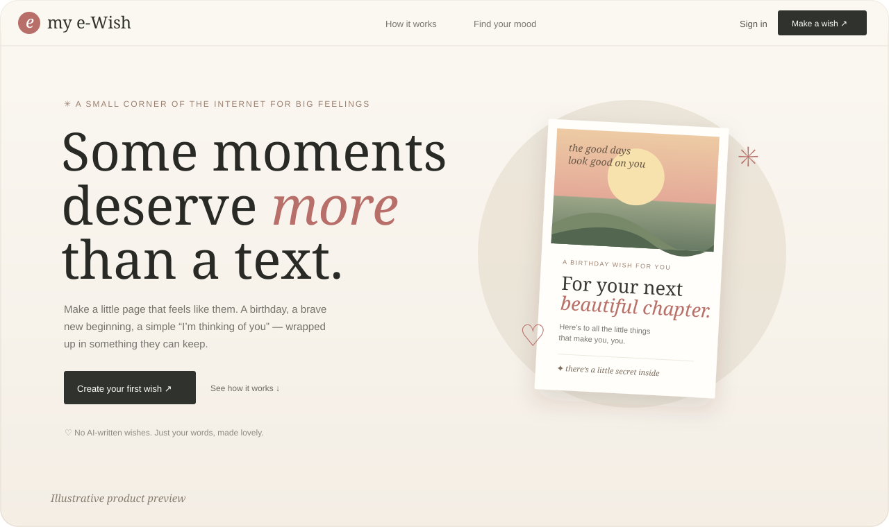
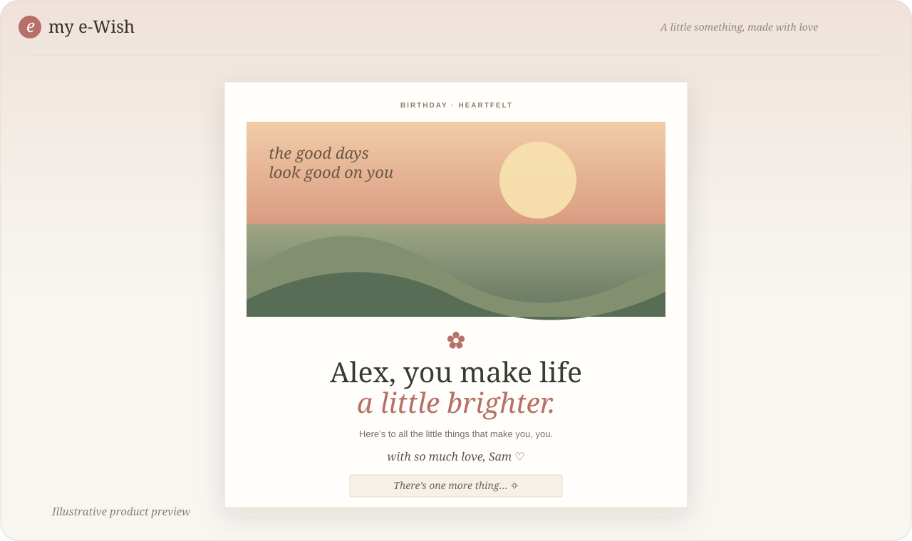

# my e-Wish

**A little corner of the internet for big feelings.**

my e-Wish is a multi-user Next.js app for making personal, shareable surprise
pages for birthdays, anniversaries, weddings, milestones, fresh starts, and
ordinary days worth remembering. Creators choose a mood, make a page their own,
add photos, then tuck in a private note, memory, quote, or question game.

> **Launch status:** The app is server-backed, but production readiness depends
> on configuring and testing MongoDB Atlas, Cloudinary, SMTP, the deployment
> domain, and admin setup in a staging environment. See [TODO.md](./TODO.md).

## A look at my e-Wish

The following original illustrations show the visual direction and sample page
layouts; they are not screenshots of a running user account. The live homepage
now uses a photo-led, animated hero that is not pictured pixel-for-pixel here.

### Homepage



### A recipient's keepsake



## Try the mood demo

Start the app and visit [`/demo`](http://localhost:3000/demo), or select **See
a live demo** from the homepage. No account is needed. Switch between
Heartfelt, Playful, Elegant, Dreamy, and Encouraging to see the composition,
imagery, details, and subtle motion change with the mood. Open the sample
personal note to preview a meaningful surprise.

Demo images are loaded from Unsplash and require an internet connection. The
Content Security Policy permits images from `images.unsplash.com` for this demo.

## What it includes

- Five distinct mood directions, each influencing recipient-page backgrounds,
  composition, decorative motifs, and motion; creators can still tune the
  accent color.
- Nine occasion treatments, including birthday, anniversary, wedding,
  achievement, goals, special moments, just because, new beginnings, and a
  creator-named occasion.
- Three independently composed recipient layouts: letter, postcard, and
  keepsake.
- A private, owner-checked preview link on every dashboard wish, including
  unpublished drafts.
- Occasions for birthdays, anniversaries, weddings, achievements, goals,
  special moments, new beginnings, and custom events.
- Personal names, headline, note, sender, cover photo, and shareable page URL.
- Surprise blocks: private reveal note, attributed quote, answer-checked
  question game, and captioned memory photo. The editor includes prompts to
  make reveal copy specific to the people sharing the page.
- Public or access-code-protected recipient pages.
- A name-first creation step that pre-fills the signed-in creator's name, plus
  60 original, locally bundled message starters across Flirty, Happy, Good
  wishes, Wealth & prosperity, and Family categories. Suggestions can be edited
  and are not saved until the creator saves the page.
- An owner-only profile with page totals and the names visitors chose to enter.
  Published pages ask visitors for a name before revealing content; private
  pages require the access code first. Visitor names are self-reported, not
  verified identities. The app stores a per-page random browser-token hash and
  the entered name in MongoDB, not the visitor's raw IP address.
- One visitor note per registered browser/page, with review counts on creator
  dashboard cards, comments grouped by wish in the owner profile, and branded
  email notifications to the page creator. If SMTP delivery fails, the note is
  kept and the visitor can retry the notification without duplicating it.
- Multi-user accounts, verified email, password reset, and owner-scoped
  experience management.
- Cloudinary image storage with server-authorized delivery.
- Branded HTML and plain-text email for verification, password reset,
  administrative support notifications, and contact messages.
- A public creator contact page and rate-limited message form.
- MFA-protected admin support access with short-lived grants, owner
  notifications, and audit history.
- Shared MongoDB rate limits, input validation, HTTP security headers, and
  same-origin mutation checks.

Motion effects respect the visitor's `prefers-reduced-motion` setting. The app
does not generate personal messages with AI.

### Visitor names and profile analytics

Creators can see the names entered by visitors in **My profile**. The visitor
form discloses this before submission, and private-page visitors first need the
page code. A name is a self-reported label, not identity verification; counts
represent registered browser/page pairs rather than guaranteed unique people.
Visitor names and random-token hashes are stored in the `experienceVisitors`
MongoDB collection. Raw IP addresses are not stored in these records. Define a
retention/deletion policy for visitor entries before public launch.
Visitors can optionally leave a short comment at the end of a published wish.
The creator sees each comment beside that visitor in their profile and receives
a branded email with the visitor-entered name, page, and comment. A browser can
leave one comment per page; comments are rate-limited and are not editable after
submission. Dashboard review-count links jump to the matching profile section.

## Technology

- Next.js App Router, React, and TypeScript
- MongoDB Atlas with the official MongoDB Node.js driver
- Auth.js Credentials, bcrypt password hashes, email verification, and MFA
- Cloudinary authenticated assets and authorization-checked image delivery
- Nodemailer SMTP, Zod request validation, and Vitest

## Run locally

Requirements: Node.js 20.9 or newer and npm.

1. Copy `.env.example` to `.env.local`.
2. Create a MongoDB Atlas database and least-privilege database user. Set
   `MONGODB_URI` and `MONGODB_DB`.
3. Generate an application secret and set `AUTH_SECRET`:

   ```bash
   node -e "console.log(require('crypto').randomBytes(32).toString('base64'))"
   ```

4. Set `NEXTAUTH_URL` to the exact local or deployed origin.
5. Set `SITE_URL` to the public site origin (for example,
   `https://your-domain.example`) in production. It is used for canonical
   metadata, structured data, `robots.txt`, and `sitemap.xml`; if omitted, the
   app falls back to `NEXTAUTH_URL`.
6. Configure SMTP: `SMTP_HOST`, `SMTP_PORT`, `SMTP_SECURE`, `SMTP_USER`,
   `SMTP_PASSWORD`, and `EMAIL_FROM`. Port 465 normally uses
   `SMTP_SECURE=true`; port 587 normally uses `false`.
7. Configure `CLOUDINARY_CLOUD_NAME`, `CLOUDINARY_API_KEY`, and
   `CLOUDINARY_API_SECRET`.
8. Optionally set `CONTACT_RECIPIENT_EMAIL` to receive messages submitted on
   the Contact page. Otherwise, the creator's public email is used.
9. To bootstrap administrators, add their exact addresses to
   `SUPPORT_ADMIN_EMAILS` or `SUPER_ADMIN_EMAILS` before they register.

Then install and start:

```bash
npm install
npm run dev
```

Visit [http://localhost:3000](http://localhost:3000). Create an account and
verify its email to manage experiences. Admins must enroll an authenticator at
`/admin/setup-mfa` before using the support console.

Never commit `.env.local`, use real production credentials in development, or
promote an account from client-controlled data.

## Commands

```bash
npm run dev        # Start local development
npm run typecheck  # TypeScript validation
npm test           # Vitest suite
npm run build      # Production build
npm start          # Serve the production build
```

## Mood and page flow

```mermaid
flowchart LR
    Visitor[Visitor] --> Demo[Explore /demo]
    Demo --> Register[Create an account]
    Register --> Mood[Choose occasion and mood]
    Mood --> Page[Choose a layout and personalize]
    Page --> Surprise[Add a personal surprise]
    Surprise --> Share[Publish or protect with a code]
    Share --> Recipient[Recipient opens the page]
    Recipient --> Reveal[Reveal the personal note or memory]
```



Mood influences the page's overall visual language—not only its accent color:

| Mood | Visual direction |
|---|---|
| Heartfelt | Warm paper, gentle heart motifs, keepsake framing |
| Playful | Brighter contrast, lively spark motifs, playful framing |
| Elegant | Botanical neutrals, fine borders, restrained ornament |
| Dreamy | Soft, atmospheric surfaces, moonlit details |
| Encouraging | Dawn-like light, sun motifs, confident composition |

These are starting styles; the creator's chosen template and accent color
remain part of the final personalization.

## Data and privacy model

- MongoDB stores account data, experience text and settings, access-code
  hashes, media references, admin grants, and audit events.
- Image binaries are stored in Cloudinary, not in MongoDB documents.
- Private page content is withheld until a valid page code is entered. Codes
  are hashed and access is granted with a scoped, expiring HttpOnly cookie.
- Quiz answers are checked on the server and omitted from recipient responses.
- Creator mutations are scoped to the authenticated owner.
- Admin support access is MFA-protected, reason-required, time-limited, and
  logged; there is no master code or unlogged private-page bypass.
- Contact-form messages are sent by email and are not persisted in MongoDB.

## Project map

```text
app/
  [slug]/                     Public recipient route
  api/                        Auth, experience, media, email, and admin routes
  components/                 Editor, dashboard, recipient, and surprise UI
  contact/                    Creator contact page and message form
  demo/                       Interactive no-login mood demo
  globals.css                 Responsive site styles and reduced-motion support
  page.tsx                    Marketing homepage
lib/
  auth.ts                     Authentication, roles, password and MFA checks
  db.ts                       MongoDB connection and indexes
  email-template.ts           Shared branded HTML and text email content
  experience-schema.ts        Server-side experience validation
  experiences.ts              Storage and recipient-data projections
  page-access.ts               Scoped private-page cookie handling
  rate-limit.ts                Shared MongoDB rate limits
  themes.ts                   Mood palette tokens
docs/previews/                 Original README preview illustrations
```

## Deployment checklist

Before public launch, complete the staging and operational work in
[TODO.md](./TODO.md), including:

- Test signup, verification, login, password reset, all page-editing flows,
  image upload, private unlock, quiz checking, contact email, and admin support
  access using production-like services.
- Verify cross-account authorization for pages and media.
- Configure HTTPS, matching `NEXTAUTH_URL` and `SITE_URL` origins, secure environment variables,
  Atlas network access and backups, SMTP sender reputation, and Cloudinary
  access controls.
- Test backup restoration, monitoring, rollback, secret rotation, privacy
  policy, retention, account deletion, and media cleanup.

## Search visibility

The public home, demo, and Contact pages have descriptive titles and metadata,
canonical URLs, Open Graph/Twitter metadata, and the home page includes
WebSite/WebApplication structured data. `robots.txt` and `sitemap.xml` are
generated from `SITE_URL`. Account, admin, and individual recipient pages are
excluded from search indexing to avoid exposing personal content. Configure
the production domain before launch, then verify the sitemap and submit it in
Google Search Console and Bing Webmaster Tools. These steps improve crawlability
and relevance but cannot guarantee a particular search ranking.

## Name

The selected product name is **my e-Wish**. Domain, social handle, and legal or
trademark availability have not been independently verified; check them before
launch.
